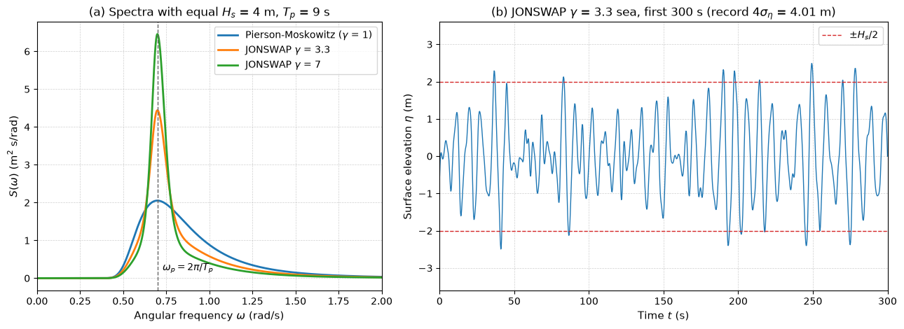

# Pierson–Moskowitz and JONSWAP Wave Spectra

This script plots the Pierson–Moskowitz and JONSWAP spectra of an irregular sea with the same significant wave height and peak period, and synthesises a random-phase time series of the surface elevation from the JONSWAP spectrum. It prints the spectral moments and characteristic periods, so the effect of the peak-enhancement factor $\gamma$ on the shape of the spectrum and on the mean periods can be read off directly.

## Overview

- Evaluates the two-parameter Pierson–Moskowitz spectrum for $H_s = 4$ m and $T_p = 9$ s.
- Evaluates the JONSWAP spectrum for $\gamma = 1$ (identical to Pierson–Moskowitz), 3.3 and 7, normalising each numerically so that $4\sqrt{m_0} = H_s$, and prints the normalising factor next to the common approximation $1 - 0.287\ln\gamma$.
- Computes the moments $m_0$, $m_1$, $m_2$ by the trapezoidal rule up to 40 rad/s and the mean periods $T_{m01} = 2\pi m_0/m_1$ and $T_z = 2\pi\sqrt{m_0/m_2}$.
- Builds a 1200 s record of surface elevation from 400 harmonic components with seeded uniform random phases and checks that $4\sigma_\eta$ of the record is close to $H_s$.

## Mathematical Background

The Pierson–Moskowitz spectrum written with $H_s$ and $\omega_p = 2\pi/T_p$ is

```math
S_{PM}(\omega) = \frac{5}{16} H_s^2\,\omega_p^4\,\omega^{-5} \exp\left[-\frac54\left(\frac{\omega_p}{\omega}\right)^4\right]
```

and the JONSWAP spectrum multiplies it by a peak-enhancement factor,

```math
S_J(\omega) = A_\gamma\,S_{PM}(\omega)\,\gamma^{r},
\qquad
r = \exp\left[-\frac{(\omega - \omega_p)^2}{2\sigma^2\omega_p^2}\right]
```

with $\sigma = 0.07$ for $\omega \le \omega_p$ and $0.09$ above. The spectral moments are $`m_n = \int_0^\infty \omega^n S\,d\omega`$, and $H_s = 4\sqrt{m_0}$ fixes $A_\gamma$. For Pierson–Moskowitz the moments are known in closed form, which gives $`T_z = T_p(1.25\pi)^{-1/4} = 0.710\,T_p`$.

A sample of the sea surface is the sum $\eta(t) = \sum_i a_i\cos(\omega_i t + \varphi_i)$ with $a_i = \sqrt{2S(\omega_i)\Delta\omega}$ and independent uniform phases, so that the variance of the record approaches $m_0$.

## Implementation

- `pierson_moskowitz(omega, hs, tp)` and `peak_enhancement(omega, gamma, tp)` evaluate the two factors.
- `jonswap(omega, gamma, hs, tp)` returns the normalised spectrum and $A_\gamma$.
- `spectral_moment(omega, s, n)` integrates $\omega^n S$.
- `random_sea(gamma, duration, n_comp, seed)` builds the time series with `numpy.random.default_rng(SEED)`.
- Constants `HS`, `TP`, `GAMMAS`, `OMEGA_MAX`, `N_OMEGA`, `N_COMPONENTS`, `DURATION` and `SEED` set the sea state and the numerics.

## Usage

```bash
python main.py                         # print the moments and show the figure
python main.py --no-show --output .    # save fluid_loading_wave_spectra.png
```

| Flag | Meaning |
| --- | --- |
| `--no-show` | Do not open a plot window |
| `--output DIR` | Create `DIR` and save the figure as a PNG |

## Output

All three spectra give $4\sqrt{m_0} = 4.000$ m. The peak spectral density rises from 2.05 m² s for Pierson–Moskowitz to 4.44 and 6.46 m² s for $\gamma = 3.3$ and 7, with $A_\gamma = 0.656$ and 0.449 (the approximation gives 0.657 and 0.442). The zero-crossing period grows with $\gamma$: $T_z = 6.39$, 7.00 and 7.46 s, because the energy is concentrated closer to the peak. The synthesised record has $4\sigma_\eta = 4.006$ m.



Panel (a) compares the spectra at equal $H_s$: the area under each curve is the same. Panel (b) shows the first 300 s of the synthesised sea; individual crests exceed $H_s/2$ several times in five minutes.

## Related Notes

- [Wave Loading on Offshore Structures](../../../notes/applied_mechanics/fluid_loading/wave_loading.md)
