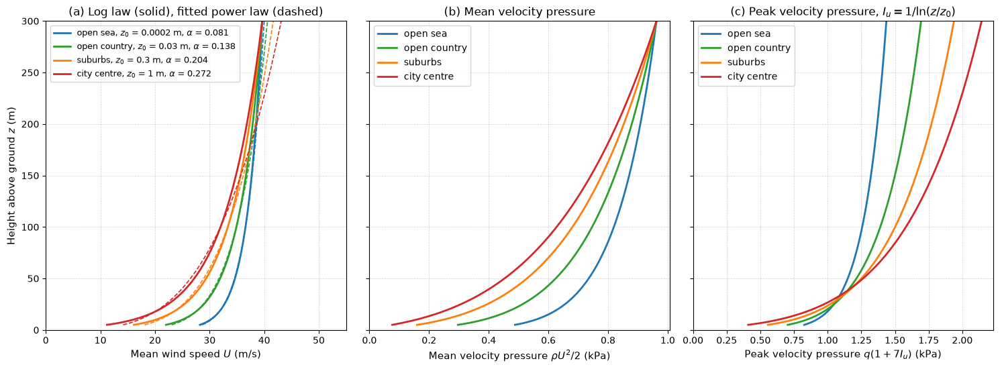

# Wind Profiles and Velocity Pressure over Four Terrains

This script plots log-law mean wind profiles over open sea, open country, suburbs and a city centre, the power-law exponent that best fits each profile, and the resulting mean and peak velocity pressure with height. It also prints the mean base shear on a 100 m tall building in each terrain, which shows that rougher terrain lowers the mean load but raises the turbulence, so that the gust-envelope load changes much less.

## Overview

- Uses the log law with roughness lengths $z_0 = 0.0002$, 0.03, 0.3 and 1 m and $\kappa = 0.41$.
- Fixes $U = 25$ m/s at 10 m over open country and, as a simple stand-in for a common wind above the surface layer, gives all terrains the same mean speed at 300 m; this fixes each friction velocity $u_*$.
- Fits $U = U_{10}(z/10)^\alpha$ to each log profile by least squares in log coordinates over 10–200 m.
- Evaluates the mean velocity pressure $q = \tfrac12\rho U^2$ and a peak velocity pressure $q(1 + 2g_p I_u)$ with $I_u = 1/\ln(z/z_0)$ and $g_p = 3.5$.
- Integrates both over the height of a 100 m × 30 m building face with $C_D = 1.3$.

## Mathematical Background

In neutral, strong winds the mean speed in the surface layer follows

```math
U(z) = \frac{u_*}{\kappa}\ln\frac{z}{z_0}
```

where $`u_*`$ is the friction velocity and $`z_0`$ the aerodynamic roughness length. The longitudinal turbulence standard deviation is roughly $`\sigma_u \approx 2.5u_*`$, so $I_u = \sigma_u/U \approx 1/\ln(z/z_0)$. The power law $U = U_{\mathrm{ref}}(z/z_{\mathrm{ref}})^\alpha$ is an empirical fit; matching the slopes of the two laws at a height $z_m$ gives $\alpha \approx 1/\ln(z_m/z_0)$, so the exponent rises with roughness. The peak velocity pressure is written in the linearised form $\tfrac12\rho U^2(1 + 2g_pI_u)$, which keeps the first-order effect of a gust $U + g_p\sigma_u$.

## Implementation

- `log_law(z, u_star, z0)`, `friction_velocity(u_ref, z_ref, z0)` and `power_law(z, u_ref, z_ref, alpha)` are the profiles.
- `fit_power_law(u_star, z0)` returns $(\alpha, U_{10})$ of the fit.
- `turbulence_intensity(z, z0)`, `velocity_pressure(u)` and `peak_velocity_pressure(z, u, z0)` give $I_u$, $q$ and the peak pressure.
- `terrain_profiles(z)` evaluates everything for the terrains in `TERRAINS`.
- `base_shear(z0, u_star, peak=False)` integrates $qC_DB$ from $\max(1\ \mathrm{m}, 2z_0)$ to the building height with the trapezoidal rule.

## Usage

```bash
python main.py                         # print the table and show the figure
python main.py --no-show --output .    # save fluid_loading_wind_profile.png
```

| Flag | Meaning |
| --- | --- |
| `--no-show` | Do not open a plot window |
| `--output DIR` | Create `DIR` and save the figure as a PNG |

## Output

| Terrain | $z_0$ (m) | $u_*$ (m/s) | $U(10)$ (m/s) | $U(100)$ (m/s) | Fitted $\alpha$ | $I_u(10)$ | Mean base shear (MN) | Peak-pressure envelope (MN) |
| --- | --- | --- | --- | --- | --- | --- | --- | --- |
| Open sea | 0.0002 | 1.14 | 30.2 | 36.6 | 0.081 | 0.092 | 2.73 | 4.30 |
| Open country | 0.03 | 1.76 | 25.0 | 34.9 | 0.138 | 0.172 | 2.28 | 4.47 |
| Suburbs | 0.3 | 2.35 | 20.1 | 33.3 | 0.204 | 0.285 | 1.90 | 4.54 |
| City centre | 1 | 2.85 | 16.0 | 32.0 | 0.272 | 0.434 | 1.61 | 4.53 |



Panel (a) shows the log profiles (solid) and their power-law fits (dashed); over the fitted range of 10–200 m they differ by at most 0.5% over open sea and 7% over the city centre, where the log profile curves most in log–log coordinates. Panel (b) shows that rough terrain lowers the mean pressure near the ground. Panel (c) shows that the higher turbulence of rough terrain largely compensates in the peak pressure. Integrating peak pressures over a whole face overestimates the load, because the peaks do not occur at all heights at once; that is what the background factor of a gust-factor method corrects.

## Related Notes

- [Wind Loading on Structures](../../../notes/applied_mechanics/fluid_loading/wind_loading.md)
