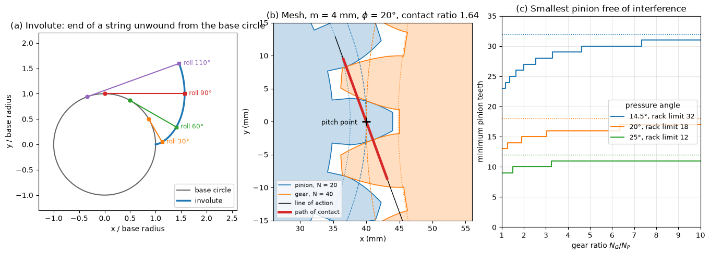

# Involute Gear Geometry

This script draws the involute construction, a standard 20° spur pinion and gear in mesh with their line of action and path of contact, and the smallest pinion that can mesh without interference as a function of gear ratio. The meshing pair is built from the involute flank equation, so the teeth touch on the line of action and the drawn path of contact gives the contact ratio directly. The interference panel compares pressure angles of 14.5°, 20° and 25°.

## Overview

- Traces the involute of a unit base circle and draws the unwound string at roll angles of 30°, 60°, 90° and 110°.
- Builds the outline of a full-depth spur gear (addendum $m$, dedendum $1.25m$) from involute flanks between the base and addendum circles, radial lines below the base circle and arcs at tip and root.
- Draws a 20-tooth pinion and a 40-tooth gear of module 4 mm in mesh, with pitch circles (dashed), base circles (dotted), the line of action and the path of contact between the two addendum circles.
- Computes the length of the path of contact and the contact ratio.
- Plots the minimum number of pinion teeth free of interference against gear ratio for three pressure angles, with the rack limit of each.

## Mathematical Background

### Involute and Tooth Thickness

The involute of a base circle of radius $r_b$ at roll angle $t$ is

$$
x = r_b(\cos t + t\sin t),
\qquad y = r_b(\sin t - t\cos t)
$$

and the string from the tangent point to the curve has length $r_b t$. At radius $\rho$ the profile makes the pressure angle $\alpha$ with $\cos\alpha = r_b/\rho$, and its polar angle is $`\mathrm{inv}\,\alpha = \tan\alpha - \alpha`$. A tooth that is half the circular pitch thick on the pitch circle (radius $r$, pressure angle $\phi$) has the half angular thickness

```math
\psi(\rho) = \frac{\pi}{2N} + \mathrm{inv}\,\phi - \mathrm{inv}\,\alpha(\rho)
```

### Path of Contact and Contact Ratio

The line of action is tangent to both base circles and passes through the pitch point at angle $\phi$ to the common tangent of the pitch circles. Contact runs between the points where the addendum circles cut it, a length

$$
Z = \sqrt{r_{a1}^2 - r_{b1}^2} + \sqrt{r_{a2}^2 - r_{b2}^2} - C\sin\phi
$$

with $C$ the centre distance. The contact ratio is $m_c = Z/p_b$, where $p_b = \pi m\cos\phi$ is the base pitch.

### Interference

The pinion flank is an involute only outside its base circle. If the gear tip reaches the line of action beyond the tangent point on the pinion base circle, it digs into the pinion flank. For full-depth teeth (addendum $`k\,m`$, $k = 1$) and gear ratio $m_G = N_G/N_P$ the smallest pinion that avoids this is

$$
N_P = \frac{2k}{(1 + 2m_G)\sin^2\phi}\left(m_G +
\sqrt{m_G^2 + (1 + 2m_G)\sin^2\phi}\right)
$$

which tends to $2k/\sin^2\phi$ for a rack.

## Implementation

- `involute(alpha)` and `involute_curve(rb, t)` implement the involute.
- `gear_geometry(n)` returns the pitch, base, addendum and root radii; `half_tooth_angle(radius, n)` the tooth half angle.
- `gear_outline(n, centre, rotation)` assembles the closed outline tooth by tooth. The gear is rotated by $\pi + \pi/N_2$ so that one of its spaces faces the pinion tooth on the line of centres.
- `contact_ratio(n1, n2)` returns $Z$ and $m_c$; `min_pinion_teeth(ratio, phi)` the interference limit (`ratio = inf` for a rack).
- Constants `MODULE`, `PINION_TEETH`, `GEAR_TEETH`, `PRESSURE_ANGLE`, `ADDENDUM` and `DEDENDUM` set the example.

## Usage

```bash
python main.py                          # print the geometry and show the figure
python main.py --no-show --output .     # save gears_involute_profile.png in the current directory
```

| Flag | Meaning |
| --- | --- |
| `--no-show` | Do not open a plot window |
| `--output DIR` | Create `DIR` and save the figure as a PNG |

## Output

The pinion has pitch radius 40.00 mm and base radius 37.59 mm, the gear 80.00 mm and 75.18 mm. The path of contact is 19.31 mm long and the base pitch 11.81 mm, so the contact ratio is 1.635: between one and two tooth pairs share the load at all times. Without interference a 20° pinion needs at least 12.32 teeth (so 13) against an equal gear and 17.10 (so 18) against a rack; at 14.5° the limits are 22.23 and 31.90, at 25° 8.36 and 11.20.



Panel (a) shows how each point of the involute is the end of a string of length $r_b t$ unwound from the base circle; the string is always normal to the curve, which is why the line of action of two involutes is a fixed straight line. In panel (b) the teeth touch on the line of action, and the red segment is the part of it where they are in contact. Panel (c) shows why 20° replaced 14.5° as the standard: it allows small pinions without undercut.

## Related Notes

- [Gears and Transmissions](../../../notes/applied_mechanics/mechanical_systems/gears.md)
- [Mechanisms and Linkages](../../../notes/applied_mechanics/mechanical_systems/mechanisms.md)
