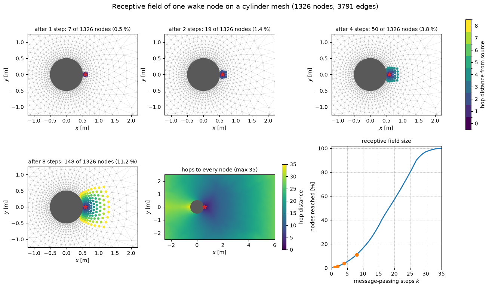
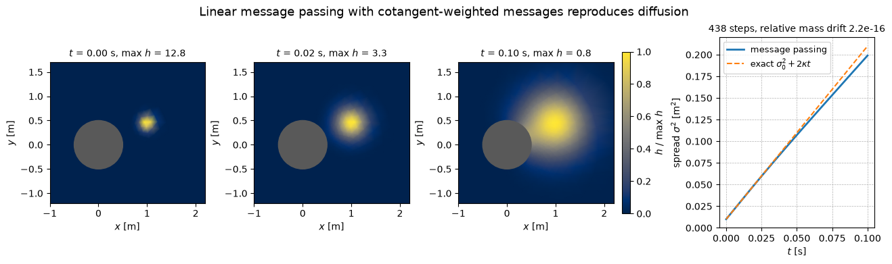

# GNN Message Passing on a Cylinder Mesh

This script shows how far information travels through a graph neural network on an unstructured CFD mesh, and that a linear message-passing layer with the right weights is a finite-volume diffusion scheme. It builds a graded triangle mesh around a circular cylinder, treats the mesh edges as the graph, and colours nodes by their hop distance from one node in the near wake to show the receptive field after 1, 2, 4 and 8 message-passing steps. A second figure runs a message-passing update whose messages are cotangent-weighted differences between neighbours and compares the spreading of a Gaussian blob with the exact diffusion rate.

## Overview

- Places nodes on concentric rings around a cylinder of radius 0.5 m, with spacing growing linearly from 0.04 m at the wall to 0.25 m, then fills the box $[-2.5, 6] \times [-2.5, 2.5]$ m with a jittered Cartesian grid of spacing 0.25 m.
- Triangulates the nodes with `scipy.spatial.Delaunay` and removes the triangles whose centroid lies inside the cylinder, giving 1326 nodes and 3791 edges.
- Computes the hop distance of every node from the node nearest $(0.62, 0)$ m by breadth-first search.
- Plots the nodes reached after $k = 1, 2, 4, 8$ steps, a map of the hop distance over the whole domain, and the percentage of nodes reached as a function of $k$.
- Builds cotangent edge weights and lumped nodal areas, and advances $\partial h/\partial t = \kappa \nabla^2 h$ with an explicit message-passing update starting from a Gaussian of standard deviation 0.1 m centred at $(1.0, 0.45)$ m.
- Plots the field at $t = 0$, 0.02 and 0.1 s and the measured spread $\sigma^2(t)$ against the free-space result $\sigma_0^2 + 2\kappa t$, and reports the drift of the integral of $h$.

## Mathematical Background

### Graph and Receptive Field

The mesh gives a graph $G = (V, E)$ with one node per mesh vertex and one undirected edge per triangle side. A message-passing layer updates node $v$ from its neighbours $\mathcal{N}(v)$ only, so after $k$ layers the state of $v$ depends only on the nodes within $k$ hops. The hop distance is the length of the shortest edge path, computed by breadth-first search: the frontier at level $\ell + 1$ is the set of unvisited neighbours of the frontier at level $\ell$.

### Message Passing as a Finite-Volume Diffusion Scheme

For piecewise-linear elements on triangles, the stiffness matrix of the Laplacian couples nodes $u$ and $v$ with the cotangent weight

$$
w_{uv} = \frac{1}{2}\left(\cot \alpha_{uv} + \cot \beta_{uv}\right)
$$

where $\alpha_{uv}$ and $\beta_{uv}$ are the angles opposite edge $uv$ in its two triangles (one angle on a boundary edge). For a piecewise-linear field, $w_{uv}(h_u - h_v)$ is the diffusive flux through the face of the median-dual control volume that crosses the edge, so the same weights define a vertex-centred finite-volume scheme. With the lumped area $A_v$ (one third of the area of the triangles that share $v$), the explicit update is

```math
h_v^{n+1} = h_v^{n} + \frac{\Delta t\, \kappa}{A_v}\sum_{u \in \mathcal{N}(v)}
w_{uv}\left(h_u^{n} - h_v^{n}\right)
```

which is a message-passing layer: the message on edge $u \to v$ is $w_{uv}(h_u - h_v)$, the aggregation is a sum, and the node update is linear. Every flux leaves one node and enters its neighbour with the opposite sign, so $\sum_v A_v h_v$ is conserved to round-off, and the boundaries are no-flux walls. On a Delaunay mesh $\alpha_{uv} + \beta_{uv} \le \pi$, so interior weights are non-negative. The code sets weights below $10^{-12}$ to zero; on this mesh that affects 11 of the 3791 edges, all of them round-off around zero where four ring nodes lie on a common circle and the two opposite angles sum to $\pi$. If

$$
\Delta t \le \min_v \frac{A_v}{\kappa \sum_u w_{uv}}
$$

each new value is a convex combination of old values, so no new maxima or minima appear. The script uses 0.9 of this limit.

### Spread of a Gaussian

In free space a Gaussian of variance $\sigma_0^2$ per direction stays Gaussian with $\sigma^2(t) = \sigma_0^2 + 2\kappa t$. The script measures $\sigma^2 = \frac{1}{2}\sum_v A_v h_v |\mathbf{x}_v - \bar{\mathbf{x}}|^2 / \sum_v A_v h_v$ about the centroid $\bar{\mathbf{x}}$.

## Implementation

- `cylinder_mesh(seed)` builds the ring and grid nodes using `spacing(wall_distance)` and returns points and triangles.
- `unique_edges(triangles)` and `adjacency(n_nodes, edges)` turn the triangulation into an edge list and a sparse adjacency matrix.
- `hop_distances(n_nodes, edges, source)` is the breadth-first search.
- `cotangent_weights(points, triangles)`, `lumped_areas(points, triangles)` and `stable_time_step(edges, weights, areas, kappa)` assemble the diffusion operator.
- `message_passing_step(h, edges, weights, areas, dt, kappa)` computes the edge messages and scatters them to the nodes with `numpy.bincount`.
- `run_diffusion(points, triangles, times)` marches the update to `SNAPSHOT_TIMES` and records $\sigma^2$ with `spread_variance`.
- `receptive_field_figure` and `diffusion_figure` draw the two figures; the mesh and diffusion constants (`RADIUS`, `H_WALL`, `SPACING_GROWTH`, `H_FAR`, `KAPPA`, `BLOB_SIGMA`) are at the top of the file.
- [`tests/test_gnn_ml.py`](../../../tests/test_gnn_ml.py) checks the BFS against `scipy.sparse.csgraph.shortest_path`, the annulus Euler characteristic $V - E + F = 0$, that the support of $k$ linear steps from a point source is exactly the $k$-hop ball, conservation and the maximum principle, and the Gaussian spreading rate on a square mesh (relative $L^2$ error below 1 %).

## Usage

```bash
python main.py                          # open the figure windows
python main.py --no-show --output out   # save both PNGs into out/
```

| Flag | Meaning |
| --- | --- |
| `--no-show` | Do not open a plot window |
| `--output DIR` | Create `DIR` and save the figures as PNGs |

## Output

`gnn_message_passing.png` shows that one step reaches 7 nodes, two steps 19, four steps 50 and eight steps 148 of the 1326 nodes (11.2 %). Because the mesh is fine near the wall, eight hops cover only about 0.84 m, less than one diameter. Half of the nodes are reached after 19 steps and all of them after 35. The hop-distance map also shows that information from the wake has to travel around the cylinder to reach the upstream region.



`gnn_message_passing_diffusion.png` shows the blob spreading over 438 explicit steps with $\Delta t = 2.3 \times 10^{-4}$ s. The relative drift of $\sum_v A_v h_v$ is $2 \times 10^{-16}$. The measured $\sigma^2$ follows the free-space line until the blob reaches the no-flux cylinder wall, and at $t = 0.1$ s $\sigma^2 = 0.199$ m² against 0.210 m² in free space.



## Related Notes

- [Graph Neural Networks for CFD](../../../notes/machine_learning/neural_networks/graph_neural_networks.md)
- [Machine Learning on Meshes](../../../notes/machine_learning/geometry/ml_with_meshes.md)
