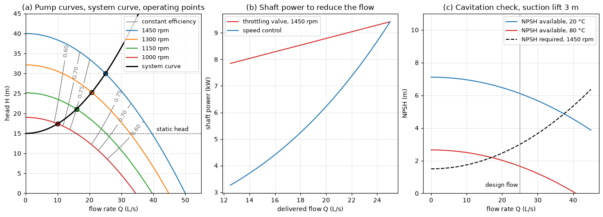

# Pump and System Curves

This script plots the head–flow curves of a centrifugal pump at four speeds from the affinity laws, the curve of the pipe system it feeds, and the operating points where they meet. Lines of constant pump efficiency are drawn over the curves. A second panel compares the shaft power needed to reduce the flow by throttling a valve with that of slowing the pump, and a third compares the net positive suction head available with the NPSH the pump requires, for water at 20 °C and at 80 °C.

## Overview

- Models the pump at 1450 rpm by $H = H_0 - AQ^2$ with $H_0 = 40$ m and $`A = 16\,000`$ s²/m⁵, and by a parabolic efficiency curve with its best efficiency point (BEP) of 78% at 25 L/s.
- Scales both curves to 1300, 1150 and 1000 rpm with the affinity laws.
- Builds the system curve from a static lift of 15 m and a 120 m pipe of 100 mm bore with Darcy friction factor 0.02 and fitting loss coefficients summing to 5.
- Finds the operating point at each speed analytically and prints flow, head, efficiency and shaft power.
- Reduces the flow from 100% to 50% of the design value either by throttling at 1450 rpm or by lowering the speed, and plots the shaft power of both.
- Evaluates NPSH available for a 3 m suction lift with suction losses $`1600\,Q^2`$ m, and NPSH required $`1.5 + 2400\,Q^2`$ m at 1450 rpm.

## Mathematical Background

### Affinity Laws

For geometrically similar operating points of the same pump at speeds $n_1$ and $n_2$,

$$
\frac{Q_2}{Q_1} = \frac{n_2}{n_1},
\qquad \frac{H_2}{H_1} = \left(\frac{n_2}{n_1}\right)^2,
\qquad \frac{P_2}{P_1} = \left(\frac{n_2}{n_1}\right)^3
$$

and the efficiency is unchanged. The head curve at speed ratio $r = n/n_0$ is therefore $H_n(Q) = r^2 H_{n_0}(Q/r)$, which for the quadratic curve is $r^2 H_0 - AQ^2$. Similar points lie on parabolas $H \propto Q^2$ through the origin.

### System Curve and Operating Point

The head the system needs to pass a flow $Q$ through a pipe of length $L$ and diameter $D$ is

$$
H_{\mathrm{sys}} = H_s + \left(f \frac{L}{D} + \sum K\right)
\frac{8Q^2}{g\pi^2 D^4} = H_s + K_{\mathrm{sys}}Q^2
$$

The pump runs where its curve meets the system curve, here at $Q = \sqrt{(r^2H_0 - H_s)/(A + K_{\mathrm{sys}})}$. The shaft power is $P = \rho g Q H/\eta$.

### Throttling and Speed Control

A throttling valve adds a loss so that the pump at rated speed delivers the reduced flow at its own, higher head. Speed control lowers $n$ until the unthrottled system curve passes through the reduced flow. Because the system curve has a static part, the new operating point is not on the similarity parabola through the BEP, and the efficiency falls as the speed drops.

### Net Positive Suction Head

With the pump a height $z$ above an open sump,

$$
\mathrm{NPSH}_a = \frac{p_{\mathrm{atm}} - p_v}{\rho g} - z - h_{f,s}
$$

where $p_v$ is the vapour pressure and $h_{f,s}$ the suction-line loss. The pump cavitates when $\mathrm{NPSH}_a$ falls below the manufacturer's $\mathrm{NPSH}_r$, which grows with flow and scales with $n^2$.

## Implementation

- `system_coefficient()` evaluates $K_{\mathrm{sys}}$ from `FRICTION_FACTOR`, `PIPE_LENGTH`, `PIPE_DIAMETER` and `MINOR_LOSS_SUM`.
- `pump_head(q, rpm)` and `pump_efficiency(q, rpm)` apply the affinity laws to the curves at `RATED_RPM`.
- `operating_point(rpm, k_sys)` and `shaft_power(q, h, eta)` give the duty point and its power.
- `efficiency_map(q, h)` finds the speed that puts the pump at $(Q, H)$ and returns the efficiency there, for the contour lines.
- `flow_reduction(k_sys, fractions)` compares throttling with speed control.
- `npsh_available(q, rho, p_vapour)` and `npsh_required(q, rpm)` evaluate the suction check; `WATER` holds density and vapour pressure at 20 °C and 80 °C.

## Usage

```bash
python main.py                          # print the operating points and show the figure
python main.py --no-show --output .     # save hydraulics_pump_system_curve.png in the current directory
```

| Flag | Meaning |
| --- | --- |
| `--no-show` | Do not open a plot window |
| `--output DIR` | Create `DIR` and save the figure as a PNG |

## Output

The system curve is $`H = 15 + 23\,962\,Q^2`$. The operating points are:

| Speed (rpm) | $Q$ (L/s) | $H$ (m) | $\eta$ | Shaft power (kW) |
| --- | --- | --- | --- | --- |
| 1450 | 25.01 | 29.99 | 0.780 | 9.42 |
| 1300 | 20.72 | 25.28 | 0.776 | 6.61 |
| 1150 | 15.95 | 21.09 | 0.750 | 4.39 |
| 1000 | 10.04 | 17.41 | 0.644 | 2.66 |

Delivering 70% of the design flow (17.51 L/s) takes 8.48 kW by throttling and 5.03 kW by running the pump at 1197 rpm. At the design flow $\mathrm{NPSH}_a$ is 6.11 m with water at 20 °C and 1.66 m at 80 °C, against $\mathrm{NPSH}_r = 3.00$ m: the same installation that is safe with cold water cavitates with hot water.



In panel (a) the operating points move down the system curve as the speed falls, and the efficiency contours show the pump leaving its best-efficiency region at the lowest speed because the static head dominates there. Panel (b) shows that throttling saves little power, since the pump keeps working against its full head, whereas speed control follows the system curve. In panel (c) the cold-water margin shrinks with flow and vanishes at about 37 L/s; with hot water there is no margin above about 17 L/s.

## Related Notes

- [Rotating Machinery](../../../notes/applied_mechanics/mechanical_systems/rotating_machinery.md)
- [Hydraulic and Pneumatic Systems](../../../notes/applied_mechanics/mechanical_systems/hydraulic_pneumatic.md)
- [Pipe Flow](../../../notes/fluid_mechanics/internal_flow/pipes.md)
