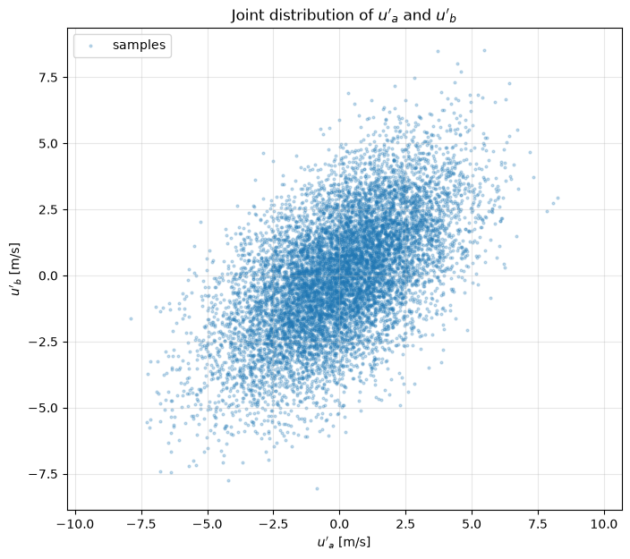

# Longitudinal Velocity Fluctuations and Projections

This script plots synthetic two-point velocity fluctuations as time traces, as a scatter cloud, and projected onto a unit vector, which are the first steps of the two-point POD example. Each probe signal is the sum of a large-scale motion shared by both probes and a faster local motion, so the two signals are correlated. The third figure projects every sample onto the trial direction $\boldsymbol{\phi} = (2, 1)/\sqrt{5} \approx (0.894, 0.447)$ and reports the variance along it.

## Overview

- Generates $`M = 10\,000`$ samples at $\Delta t = 1$ ms of $u'_a = s + \ell_a$ and $u'_b = s + \ell_b$, where $s$, $\ell_a$ and $\ell_b$ are independent, seeded, stationary first-order autoregressive signals, and removes the sample means.
- Stores the data as a $2 \times M$ matrix, points in rows and samples in columns, the convention of [the shared POD code](../../_numerics.py).
- Figure 1: the first 0.25 s of $u'_a(t)$ and $u'_b(t)$.
- Figure 2: scatter plot of the $(u'_a, u'_b)$ pairs, whose tilted elliptical shape shows the correlation.
- Figure 3: the cloud, the line along $\boldsymbol{\phi}$, and each sample's projection $a_j\boldsymbol{\phi}$ drawn as a red point on that line.
- Prints the covariance matrix, the correlation coefficient, the fluctuation energy $`\frac{1}{2}\mathrm{tr}\,\mathbf{C}`$ and the variance along $\boldsymbol{\phi}$.

## Mathematical Background

### Signal Model

Each component is an AR(1) process with correlation time $\tau$ and variance $\sigma^2$,

```math
x_{j+1} = r\,x_j + \sqrt{\sigma^2(1 - r^2)}\,\xi_j, \qquad r = e^{-\Delta t/\tau}, \qquad \xi_j \sim \mathcal{N}(0, 1)
```

whose autocorrelation is $e^{-|t|/\tau}$. The shared motion $s$ has $\sigma_s^2 = 2.8$ m²/s² and $\tau_s = 10$ ms; the local motions have $\sigma_\ell^2 = 2.2$ m²/s² and $\tau_\ell = 2$ ms. Because $s$, $\ell_a$ and $\ell_b$ are independent, the exact covariance matrix is

```math
\mathbf{C} = \begin{bmatrix} \sigma_s^2 + \sigma_\ell^2 & \sigma_s^2 \\ \sigma_s^2 & \sigma_s^2 + \sigma_\ell^2 \end{bmatrix} = \begin{bmatrix} 5.0 & 2.8 \\ 2.8 & 5.0 \end{bmatrix}
```

with correlation coefficient $\rho_{ab} = 2.8/5.0 = 0.56$, eigenvalues $2\sigma_s^2 + \sigma_\ell^2 = 7.8$ and $\sigma_\ell^2 = 2.2$, and eigenvectors $(1, \pm 1)/\sqrt{2}$.

### Covariance and Projection

With the $2 \times M$ fluctuation matrix $\mathbf{U}$, whose column $j$ is $`\mathbf{u}'_j = (u'_{a,j}, u'_{b,j})^T`$,

```math
\mathbf{C} = \frac{1}{M-1}\mathbf{U}\mathbf{U}^T, \qquad a_j = \boldsymbol{\phi}^T\mathbf{u}'_j, \qquad \mathrm{var}_{\boldsymbol{\phi}} = \frac{1}{M-1}\sum_{j=1}^M a_j^2 = \boldsymbol{\phi}^T\mathbf{C}\,\boldsymbol{\phi}
```

POD looks for the unit vector that maximises $\boldsymbol{\phi}^T\mathbf{C}\boldsymbol{\phi}$; the solution is the leading eigenvector of $\mathbf{C}$. The trial vector $(0.894, 0.447)$ gives more variance than either axis but less than $\lambda_1$. The companion script [eigenvector_projection](../eigenvector_projection/README.md) computes the optimal directions from the same data.

## Implementation

- `ar1_process(n, dt, tau, variance, rng)` generates one stationary AR(1) signal, starting from a sample of its stationary distribution.
- `generate_fluctuations(n, dt, seed)` returns the time array and the zero-mean $2 \times n$ data (`N_SAMPLES`, `DT`, `TAU_SHARED`, `TAU_LOCAL`, `VAR_SHARED`, `VAR_LOCAL`, `SEED`).
- `covariance(data)` returns $\mathbf{U}\mathbf{U}^T/(M-1)$.
- `project(data, phi)` returns the scalar projections $a_j$ and the projected points $a_j\boldsymbol{\phi}$.
- `plot_time_series`, `plot_scatter` and `plot_projection` build the three figures; the two scatter figures use equal axis scaling.
- `main(argv=None)` prints the statistics and shows or saves the figures.

## Usage

```bash
python main.py                          # open the three figure windows
python main.py --no-show --output out   # save the three PNGs into out/
```

| Flag | Meaning |
| --- | --- |
| `--no-show` | Do not open plot windows |
| `--output DIR` | Create `DIR` and save `velocity_fluctuations_time_series.png`, `velocity_fluctuations_scatter.png`, and `velocity_fluctuations_projection.png` |

## Output

With the default seed the script prints

```math
\mathbf{C} = \begin{bmatrix} 5.074 & 2.991 \\ 2.991 & 5.195 \end{bmatrix}\ \text{m}^2/\text{s}^2, \qquad \rho_{ab} = 0.583, \qquad \tfrac{1}{2}\mathrm{tr}\,\mathbf{C} = 5.134\ \text{m}^2/\text{s}^2, \qquad \mathrm{var}_{\boldsymbol{\phi}} = 7.491\ \text{m}^2/\text{s}^2
```

The sample values differ from the exact ones by a few percent because the shared motion is correlated over about ten samples, which reduces the effective number of independent samples.

Figure 1 shows the two signals following each other on the slow time scale of the shared motion and departing from each other on the faster local scale.


Figure 2 shows the tilted elliptical cloud of $(u'_a, u'_b)$ pairs.



Figure 3 shows the red projected points lying on the black line through the origin along $\boldsymbol{\phi}$.


## Related Notes

- [Two-Point POD: A Worked Example](../../../notes/numerical/pod/derivation_in_2d.md)
- [POD for N Points](../../../notes/numerical/pod/derivation_in_n_dim.md)
- [Reynolds Decomposition](../../../notes/fluid_mechanics/turbulence/reynolds_decomposition.md)
- [Turbulence Statistics](../../../notes/fluid_mechanics/turbulence/statistics.md)
