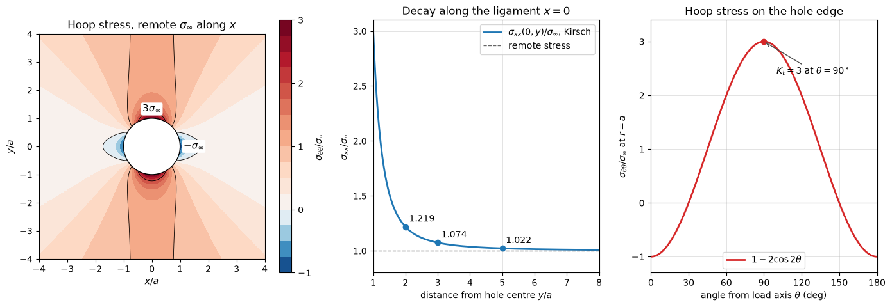

# Kirsch Stress Field Around a Hole

This script plots the closed-form Kirsch stress field around a circular hole in a plate under uniaxial tension and shows the stress concentration factor of 3 at the hole edge. An infinite linear elastic plate with a hole of radius $a$ carries a remote stress $\sigma_\infty$ along $x$. The figure shows the hoop stress around the hole, the decay of $\sigma_{xx}$ along the ligament $x = 0$, which illustrates Saint-Venant's principle, and the hoop stress on the hole edge as a function of angle.

## Overview

- Evaluates the Kirsch solution for $\sigma_{rr}$, $\sigma_{\theta\theta}$ and $\tau_{r\theta}$ on a $401 \times 401$ grid over $-4a \le x, y \le 4a$.
- Converts the polar components to Cartesian ones where needed.
- Plots $\sigma_{\theta\theta}/\sigma_\infty$ with a diverging colour map centred on zero and contour lines at 0, 1 and 2.
- Plots $\sigma_{xx}/\sigma_\infty$ along $x = 0$ from the hole edge to $8a$, with values marked at $2a$, $3a$ and $5a$.
- Plots the hoop stress on the edge, $1 - 2\cos 2\theta$, for $0 \le \theta \le 180^\circ$.
- Prints the edge values at $0^\circ$ and $90^\circ$ and the ligament stress at four distances.

## Mathematical Background

With $\theta$ measured from the load axis,

```math
\sigma_{rr} = \frac{\sigma_\infty}{2}\left(1 - \frac{a^2}{r^2}\right) + \frac{\sigma_\infty}{2}\left(1 - \frac{4a^2}{r^2} + \frac{3a^4}{r^4}\right)\cos 2\theta,
\qquad
\sigma_{\theta\theta} = \frac{\sigma_\infty}{2}\left(1 + \frac{a^2}{r^2}\right) - \frac{\sigma_\infty}{2}\left(1 + \frac{3a^4}{r^4}\right)\cos 2\theta
```

```math
\tau_{r\theta} = -\frac{\sigma_\infty}{2}\left(1 + \frac{2a^2}{r^2} - \frac{3a^4}{r^4}\right)\sin 2\theta
```

At $r = a$ the hole is traction free ($\sigma_{rr} = \tau_{r\theta} = 0$) and $\sigma_{\theta\theta} = \sigma_\infty(1 - 2\cos 2\theta)$, which is $3\sigma_\infty$ at $\theta = 90^\circ$ and $-\sigma_\infty$ at $\theta = 0$. Far from the hole the field tends to $\sigma_{xx} = \sigma_\infty$. On the line $x = 0$, $\theta = 90^\circ$ and

$$
\frac{\sigma_{xx}}{\sigma_\infty} = 1 + \frac{a^2}{2r^2} + \frac{3a^4}{2r^4}
$$

whose integral from $a$ to $R$ tends to $\sigma_\infty R$: the ligament carries the load that the missing material would have carried.

## Implementation

- `kirsch_polar(r, theta, a, sigma)` returns $(\sigma_{rr}, \sigma_{\theta\theta}, \tau_{r\theta})$.
- `kirsch_cartesian(x, y, a, sigma)` rotates them to $(\sigma_{xx}, \sigma_{yy}, \tau_{xy})$.
- `ligament_stress(r_over_a)` gives $\sigma_{xx}/\sigma_\infty$ on $x = 0$.
- `make_figure()` draws the three panels. Constants `RADIUS`, `SIGMA_INF`, `EXTENT` and `GRID` set the scale and resolution; results depend only on $r/a$ and are proportional to $\sigma_\infty$.

## Usage

```bash
python main.py                          # open the figure window
python main.py --no-show --output .     # save materials_kirsch_hole.png
```

| Flag | Meaning |
| --- | --- |
| `--no-show` | Do not open a plot window |
| `--output DIR` | Create `DIR` and save the figure as a PNG |

## Output

The script prints

```text
hoop stress at the hole edge: theta = 90 deg 3.000, theta = 0 deg -1.000 (times sigma_inf)
sigma_xx/sigma_inf on x = 0 at y = 1.5 a: 1.5185
sigma_xx/sigma_inf on x = 0 at y = 2.0 a: 1.2188
sigma_xx/sigma_inf on x = 0 at y = 3.0 a: 1.0741
sigma_xx/sigma_inf on x = 0 at y = 5.0 a: 1.0224
```



The left panel shows the two red lobes of high hoop stress above and below the hole and the two blue regions of compression on the load axis. The centre panel shows how quickly the disturbance decays: within two radii of the centre the stress is already within 22% of the remote value, and within five radii within about 2%. The right panel gives the stress concentration factor $K_t = 3$ at $\theta = 90^\circ$ and the zero crossings at $\theta = 30^\circ$ and $150^\circ$.

## Related Notes

- [Stress and Strain](../../../notes/applied_mechanics/strength_materials/stress_strain.md)
- [Axial Loading](../../../notes/applied_mechanics/strength_materials/axial_loading.md)
