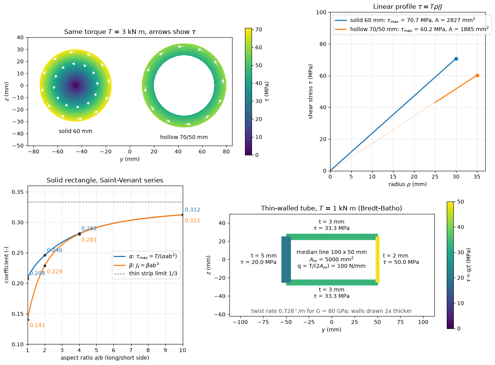

# Torsional Shear Stress Distribution

This script plots torsional shear stress in solid, hollow, rectangular and thin-walled closed sections. A solid shaft of 60 mm diameter and a hollow shaft of 70 mm outer and 50 mm inner diameter carry the same torque, which shows the linear stress profile and why hollow shafts save material. The torsion coefficients of a solid rectangle are computed from Saint-Venant's series solution, and a thin-walled rectangular tube with walls of different thickness illustrates the constant shear flow of the Bredt–Batho formula.

## Overview

- Colours the solid and hollow cross-sections by $\tau = T\rho/J$ under $T = 3$ kN m, with arrows showing the direction of the shear stress (`TORQUE_SHAFT`, `D_SOLID`, `D_OUTER`, `D_INNER`).
- Plots $\tau$ against radius for both shafts and labels the peak stress and the area of each.
- Evaluates the rectangle coefficients $\alpha(a/b)$ and $\beta(a/b)$ from 60 odd terms of the series for $1 \le a/b \le 10$, marking the values at $a/b = 1, 2, 4, 10$.
- Computes the shear flow, wall stresses and twist rate of a $100 \times 50$ mm (median line) tube with walls of 3, 3, 5 and 2 mm under 1 kN m, with $G = 80$ GPa (`TUBE_WIDTH`, `TUBE_HEIGHT`, `TUBE_WALLS`, `TORQUE_TUBE`, `SHEAR_MODULUS`), and draws the walls twice their true thickness, coloured by stress.
- Prints the polar moments, peak stresses, a table of $\alpha$ and $\beta$, and the tube results.

## Mathematical Background

For circular shafts

$$
\tau = \frac{T\rho}{J},
\qquad J = \frac{\pi}{32}\left(d_o^4 - d_i^4\right)
$$

For a solid rectangle with long side $a$ and short side $b$, $\tau_{\max} = T/(\alpha a b^2)$ and the torsion constant is $J_t = \beta a b^3$. Saint-Venant's solution (Timoshenko and Goodier) gives, with sums over odd $n$,

```math
\beta = \frac{1}{3}\left[1 - \frac{192}{\pi^5}\frac{b}{a}\sum_{n = 1, 3, \dots}\frac{1}{n^5}\tanh\frac{n\pi a}{2b}\right],
\qquad
\alpha = \beta\left[1 - \frac{8}{\pi^2}\sum_{n = 1, 3, \dots}\frac{1}{n^2\cosh(n\pi a/2b)}\right]^{-1}
```

For a thin-walled closed section with enclosed median area $A_m$ and wall thickness $t(s)$, the shear flow $q = \tau t$ is constant and

```math
q = \frac{T}{2A_m},
\qquad
\tau = \frac{q}{t},
\qquad
\frac{d\phi}{dx} = \frac{T}{4A_m^2 G}\oint\frac{ds}{t}
```

## Implementation

- `polar_moment(d_outer, d_inner)` and `shaft_shear(torque, rho, d_outer, d_inner)` implement the circular-shaft formulas.
- `rectangle_coefficients(aspect, terms)` evaluates the two series, writing $1/\cosh$ in a form that does not overflow.
- `tube_properties(torque, width, height, walls, shear_modulus)` returns the shear flow, a dictionary of wall stresses and the twist rate.
- `draw_sections(ax)` draws the coloured cross-sections; `make_figure()` lays out the four panels.

## Usage

```bash
python main.py                          # open the figure window
python main.py --no-show --output .     # save materials_torsion_shear_distribution.png
```

| Flag | Meaning |
| --- | --- |
| `--no-show` | Do not open a plot window |
| `--output DIR` | Create `DIR` and save the figure as a PNG |

## Output

The script prints

```text
solid 60 mm: J = 1.272e+06 mm^4, tau_max = 70.74 MPa, area = 2827 mm^2
hollow 70/50: J = 1.744e+06 mm^4, tau_max = 60.22 MPa, area = 1885 mm^2
a/b =  1.0: alpha = 0.2082, beta = 0.1406
a/b =  1.5: alpha = 0.2310, beta = 0.1958
a/b =  2.0: alpha = 0.2459, beta = 0.2287
a/b =  3.0: alpha = 0.2672, beta = 0.2633
a/b =  4.0: alpha = 0.2817, beta = 0.2808
a/b =  6.0: alpha = 0.2984, beta = 0.2983
a/b = 10.0: alpha = 0.3123, beta = 0.3123
tube: q = 100000 N/m, tau (MPa): top 33.3, bottom 33.3, left 20.0, right 50.0, twist rate = 1.271e-02 rad/m
```



The hollow shaft (top) has a 15% lower peak stress than the solid one while using a third less material; the dotted line shows that the material it omits would have carried less than 43 MPa. The rectangle coefficients (lower left) start at 0.208 and 0.141 for a square and approach $1/3$ for a thin strip. In the tube (lower right) the same shear flow of 100 N/mm gives 50 MPa in the 2 mm wall and 20 MPa in the 5 mm wall.

## Related Notes

- [Torsion](../../../notes/applied_mechanics/strength_materials/torsion.md)
- [Combined Loading](../../../notes/applied_mechanics/strength_materials/combined_loading.md)
