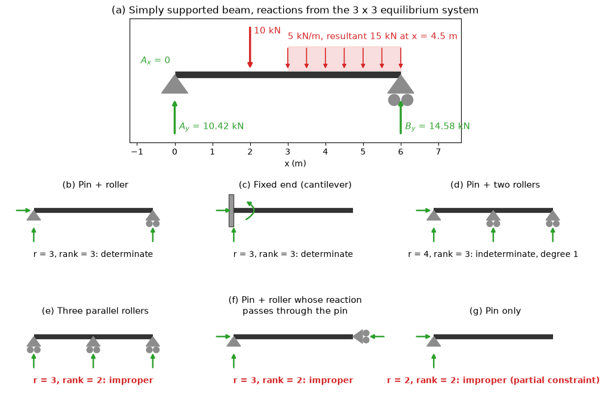

# Support Reactions and Constraint

This script solves the reactions of a simply supported beam from the $3 \times 3$ equilibrium system and classifies support layouts as determinate, indeterminate or improper from the rank of the reaction matrix. Each reaction component contributes one column to a $3 \times r$ matrix; three independent columns are needed to hold a planar rigid body, and counting reactions alone does not detect parallel or concurrent supports.

## Overview

- Expands pins, rollers and fixed supports into reaction components: one force for a roller, two for a pin, two and a couple for a fixed support.
- Builds the reaction matrix whose columns are the force components and the moment about the origin of each unit reaction.
- Classifies a layout from $r$ and the matrix rank as determinate ($r = 3$, rank 3), indeterminate of degree $r - 3$ (rank 3) or improper (rank below 3).
- Solves the reactions of a 6 m beam on a pin and a roller carrying 10 kN at 2 m and 5 kN/m on its last 3 m.
- Draws the beam's free-body diagram and six support layouts with their reaction components and classification.

## Mathematical Background

A unit force with direction $(d_x, d_y)$ at $(x, y)$ has the moment $x d_y - y d_x$ about the origin, and a unit couple has components $(0, 0, 1)$. Stacking these as columns gives $\mathbf{A}$, and equilibrium of the body is

```math
\mathbf{A}\,\mathbf{R} = -\begin{bmatrix} \sum F_x \\ \sum F_y \\ \sum M_O \end{bmatrix}_{\mathrm{loads}}
```

The body is properly constrained when $`\mathrm{rank}\,\mathbf{A} = 3`$. Parallel reactions make the first two rows dependent, and reactions concurrent at a point $P$ make the moment row a combination of the force rows (moments about $P$ are zero for all of them).

## Implementation

- `reaction_components(supports)` expands a list of `(type, (x, y), normal)` supports.
- `reaction_matrix(supports)` and `classify_supports(supports)` return the matrix and `(r, rank, label)`.
- `load_resultant(forces, couples)` sums the loads and `solve_reactions(supports, forces, couples)` solves a determinate layout, raising `ValueError` otherwise.
- `example_beam()` returns the worked beam, and `LAYOUTS` holds the six classified layouts.
- `draw_support`, `draw_reactions` and `make_figure()` draw the figure.

## Usage

```bash
python main.py                          # print the results and show the figure
python main.py --no-show --output .     # save statics_support_reactions.png in the current directory
```

| Flag | Meaning |
| --- | --- |
| `--no-show` | Do not open a plot window |
| `--output DIR` | Create `DIR` and save the figure as a PNG |

## Output

```text
beam reactions: A_x = 0.00 kN, A_y = 10.42 kN, B_y = 14.58 kN
Pin + roller                                       r = 3, rank = 3: determinate
Fixed end (cantilever)                             r = 3, rank = 3: determinate
Pin + two rollers                                  r = 4, rank = 3: indeterminate, degree 1
Three parallel rollers                             r = 3, rank = 2: improper
Pin + roller whose reaction passes through the pin r = 3, rank = 2: improper
Pin only                                           r = 2, rank = 2: improper (partial constraint)
```



Layouts (e) and (f) have the three reactions that the count asks for, yet cannot resist a horizontal load and a moment about the pin respectively.

## Related Notes

- [Rigid Body Equilibrium](../../../notes/applied_mechanics/statics/rigid_body_equilibrium.md)
- [Structural Analysis](../../../notes/applied_mechanics/statics/structural_analysis.md)
