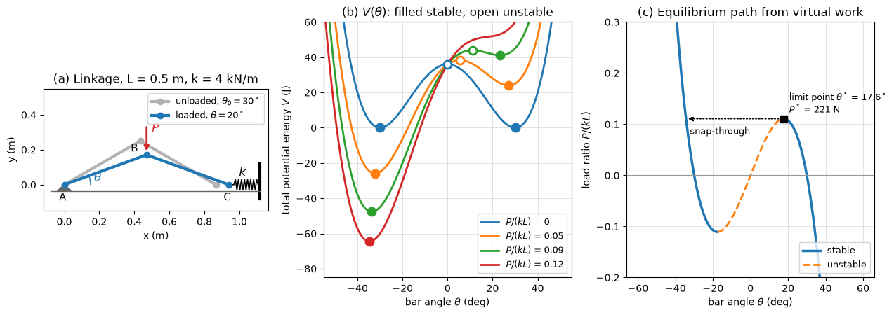

# Virtual Work and Stability

This script plots the potential energy of a spring-loaded two-bar linkage for several loads with its stable and unstable equilibria, and its equilibrium path from the virtual-work equation with the snap-through limit point. Two rigid bars of length $L = 0.5$ m form an inverted V with a pin at one end and a roller at the other; a horizontal spring of stiffness $k = 4$ kN/m holds the roller and is unstretched at $\theta_0 = 30^\circ$, and a downward load $P$ acts at the apex.

## Overview

- Evaluates the total potential energy $V(\theta)$ and its first two derivatives analytically.
- Finds every equilibrium in $-55^\circ \leq \theta \leq 55^\circ$ for $P/(kL) = 0, 0.05, 0.09, 0.12$ by locating sign changes of $dV/d\theta$ on a grid and refining them by bisection, and classifies each by the sign of $d^2V/d\theta^2$.
- Computes the load that holds any angle from the virtual-work equation, and the limit point in closed form.
- Draws the linkage, the energy curves with stable (filled) and unstable (open) equilibria, and the equilibrium path with the snap-through jump.

## Mathematical Background

With $y_B = L\sin\theta$, $x_C = 2L\cos\theta$ and spring compression $s = 2L(\cos\theta - \cos\theta_0)$, the total potential energy is

```math
V(\theta) = 2kL^2(\cos\theta - \cos\theta_0)^2 + PL\sin\theta
```

Equilibrium $dV/d\theta = 0$ is the virtual-work equation, which gives the load on the equilibrium path:

```math
\frac{dV}{d\theta} = -4kL^2(\cos\theta - \cos\theta_0)\sin\theta + PL\cos\theta = 0
\implies P = 4kL(\cos\theta - \cos\theta_0)\tan\theta
```

Stability requires

```math
\frac{d^2V}{d\theta^2} = 4kL^2\left(\sin^2\theta - \cos^2\theta + \cos\theta\cos\theta_0\right) - PL\sin\theta > 0
```

The path has a maximum where $dP/d\theta = 0$, which reduces to $\cos^3\theta^* = \cos\theta_0$, with $P^* = 4kL\sin^3\theta^*$; there $d^2V/d\theta^2 = 0$.

## Implementation

- `potential_energy`, `dv_dtheta` and `d2v_dtheta2` take the angle (rad) and the load (N), with `k`, `length` and `theta0` as keyword arguments.
- `equilibrium_load(theta)` evaluates the virtual-work load and `limit_point()` returns $`(\theta^*, P^*)`$.
- `equilibria(load)` returns a sorted list of `(theta, stable)` pairs, including grid points where $dV/d\theta$ is exactly zero.
- `zigzag` and `draw_linkage` draw the schematic; `make_figure()` draws all three panels.
- Constants `BAR_LENGTH`, `SPRING_STIFFNESS`, `THETA0`, `LOAD_RATIOS` and `THETA_PLOT` set the case.

## Usage

```bash
python main.py                          # print the equilibria and show the figure
python main.py --no-show --output .     # save statics_virtual_work_stability.png in the current directory
```

| Flag | Meaning |
| --- | --- |
| `--no-show` | Do not open a plot window |
| `--output DIR` | Create `DIR` and save the figure as a PNG |

## Output

```text
limit point: theta* = 17.60 deg, P* = 221.2 N (P*/kL = 0.1106)
P/(kL) = 0: -30.00 deg (stable), +0.00 deg (unstable), +30.00 deg (stable)
P/(kL) = 0.05: -32.20 deg (stable), +5.52 deg (unstable), +27.07 deg (stable)
P/(kL) = 0.09: -33.67 deg (stable), +11.02 deg (unstable), +23.34 deg (stable)
P/(kL) = 0.12: -34.65 deg (stable)
```



Panel (b) shows the right-hand energy well becoming shallower as $P$ grows and vanishing above $P/(kL) = 0.1106$; at $P/(kL) = 0.12$ only the snapped-through equilibrium remains. Panel (c) shows the stable branch (solid) and the unstable branch (dashed) meeting at the limit point, and the jump at constant load to the inverted configuration.

## Related Notes

- [Virtual Work and Stability of Equilibrium](../../../notes/applied_mechanics/statics/virtual_work.md)
- [Buckling](../../../notes/applied_mechanics/strength_materials/buckling.md)
